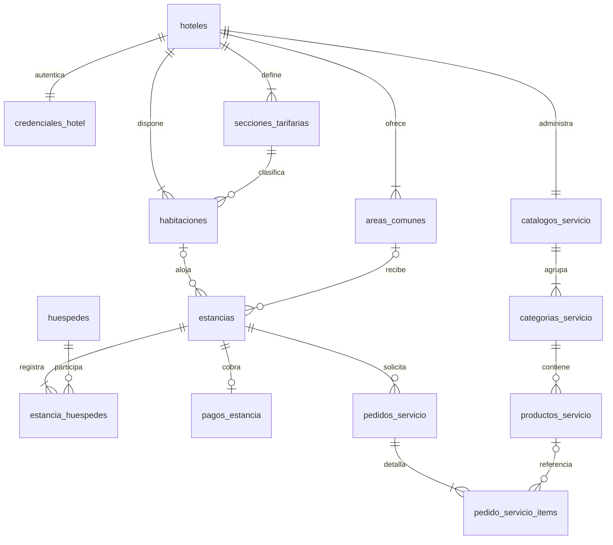

# Modelo activo: SQL Server, 14 tablas

Este documento corresponde al backend Spring Boot/JDBC/HikariCP y al instalador CREAR_GESTERA_SQLSERVER.sql. Se genera desde esquema/01_tablas.sql con herramientas/documentar-modelo-sqlserver.py.

## Correspondencia con la referencia visual

Hotel, habitación, huésped, área, servicio y pago mantienen entidades propias. La entrada, la salida y la ocupación pertenecen a estancias; el seguimiento de limpieza utiliza el estado de la habitación. Se modelan también tarifas, credenciales y catálogo porque forman parte del funcionamiento real de Gestera.

La relación N:M entre huéspedes y estancias se resuelve con estancia_huespedes. Categorías y productos usan claves compuestas por catálogo. Los snapshots conservan hechos históricos aunque cambie el catálogo.

## hoteles

Identidad y ubicación de cada establecimiento.

| Atributo | Significado | Tipo | Clave y reglas |
|---|---|---|---|
| codigo | Identificador estable usado por Java y los formularios. | NVARCHAR(80) | PK; NOT NULL PRIMARY KEY |
| nombre | Nombre visible en las pantallas. | NVARCHAR(150) | NOT NULL UNIQUE |
| ubicacion | Ubicación del establecimiento. | NVARCHAR(150) | NOT NULL |
| iniciales | Dos caracteres mostrados en el selector de hoteles. | CHAR(2) | NOT NULL |
| activo | Permite mostrar el hotel en el catálogo operativo. | BIT | NOT NULL DEFAULT 1 |
| creado_en | Fecha de creación del registro. | DATETIME2(7) | NOT NULL DEFAULT SYSUTCDATETIME(); Auditoría automática en UTC, salvo la fecha de negocio proporcionada para pedidos. |
| actualizado_en | Fecha del último cambio del registro. | DATETIME2(7) | NOT NULL DEFAULT SYSUTCDATETIME(); Auditoría UTC; en pedidos es la hora local del último cambio de estado. |

## credenciales_hotel

Material PBKDF2 y versión de la llave independiente del hotel.

| Atributo | Significado | Tipo | Clave y reglas |
|---|---|---|---|
| hotel_codigo | Hotel propietario del registro. | NVARCHAR(80) | PK/FK; NOT NULL PRIMARY KEY |
| sal | Dato aleatorio usado al derivar la llave. | VARBINARY(16) | NOT NULL; 16 bytes aleatorios, distintos por credencial. |
| hash_clave | Resultado de la derivación criptográfica de la llave. | VARBINARY(32) | NOT NULL; 32 bytes derivados; no contiene la llave en texto claro. |
| algoritmo | Algoritmo de derivación admitido: PBKDF2WithHmacSHA256. | VARCHAR(40) | NOT NULL DEFAULT 'PBKDF2WithHmacSHA256' |
| iteraciones | Costo de la derivación; entre 10000 y 10000000. | INT | NOT NULL DEFAULT 65536 |
| version | Contador de cambios para controlar concurrencia. | BIGINT | NOT NULL DEFAULT 1 |
| requiere_cambio | Indica que todavía se debe completar el cambio inicial de llave. | BIT | NOT NULL DEFAULT 1 |
| actualizado_en | Fecha del último cambio del registro. | DATETIME2(7) | NOT NULL DEFAULT SYSUTCDATETIME(); Auditoría UTC; en pedidos es la hora local del último cambio de estado. |

Relaciones: (hotel_codigo) → hoteles(codigo).

## secciones_tarifarias

Catálogo de colores y tarifas de seis y veinticuatro horas.

| Atributo | Significado | Tipo | Clave y reglas |
|---|---|---|---|
| id | Identificador interno generado por SQL Server. | BIGINT | PK; IDENTITY NOT NULL PRIMARY KEY |
| hotel_codigo | Hotel propietario del registro. | NVARCHAR(80) | FK; NOT NULL |
| codigo | Identificador estable usado por Java y los formularios. | VARCHAR(60) | NOT NULL |
| nombre | Nombre visible en las pantallas. | NVARCHAR(40) | NOT NULL |
| color_hex | Color actual de la sección, en formato #RRGGBB. | CHAR(7) | NOT NULL |
| precio_seis_horas | Tarifa actual de alojamiento de seis horas, en PEN. | DECIMAL(10,2) | NOT NULL |
| precio_dia_completo | Tarifa actual de alojamiento de veinticuatro horas, en PEN. | DECIMAL(10,2) | NOT NULL |
| creado_en | Fecha de creación del registro. | DATETIME2(7) | NOT NULL DEFAULT SYSUTCDATETIME(); Auditoría automática en UTC, salvo la fecha de negocio proporcionada para pedidos. |
| actualizado_en | Fecha del último cambio del registro. | DATETIME2(7) | NOT NULL DEFAULT SYSUTCDATETIME(); Auditoría UTC; en pedidos es la hora local del último cambio de estado. |

Relaciones: (hotel_codigo) → hoteles(codigo).

## habitaciones

Inventario permanente y estado operativo de cada cuarto.

| Atributo | Significado | Tipo | Clave y reglas |
|---|---|---|---|
| id | Identificador interno generado por SQL Server. | BIGINT | PK; IDENTITY NOT NULL PRIMARY KEY |
| hotel_codigo | Hotel propietario del registro. | NVARCHAR(80) | FK; NOT NULL |
| numero | Número visible de habitación, entre 1 y 50 dentro de su hotel. | SMALLINT | NOT NULL |
| seccion_tarifaria_id | Sección de tarifas asignada a la habitación. | BIGINT | FK; NOT NULL |
| estado | DISPONIBLE, OCUPADA, LIMPIEZA_PENDIENTE, EN_LIMPIEZA o MANTENIMIENTO. | VARCHAR(24) | NOT NULL DEFAULT 'DISPONIBLE' |
| tipo_servicio_preferido | Selección guardada: SEIS_HORAS o DIA_COMPLETO. | VARCHAR(20) | NOT NULL DEFAULT 'SEIS_HORAS'; Conserva la selección de servicio incluso cuando el cuarto está disponible. |
| activa | Incluye la habitación en el inventario actual. | BIT | NOT NULL DEFAULT 1; Baja lógica: reducir el inventario conserva las referencias históricas. |
| creado_en | Fecha de creación del registro. | DATETIME2(7) | NOT NULL DEFAULT SYSUTCDATETIME(); Auditoría automática en UTC, salvo la fecha de negocio proporcionada para pedidos. |
| actualizado_en | Fecha del último cambio del registro. | DATETIME2(7) | NOT NULL DEFAULT SYSUTCDATETIME(); Auditoría UTC; en pedidos es la hora local del último cambio de estado. |

Relaciones: (hotel_codigo) → hoteles(codigo); (seccion_tarifaria_id,hotel_codigo) → secciones_tarifarias(id,hotel_codigo).

## areas_comunes

Espacios disponibles para registrar visitas de cada hotel.

| Atributo | Significado | Tipo | Clave y reglas |
|---|---|---|---|
| id | Identificador interno generado por SQL Server. | BIGINT | PK; IDENTITY NOT NULL PRIMARY KEY |
| hotel_codigo | Hotel propietario del registro. | NVARCHAR(80) | FK; NOT NULL |
| codigo | Identificador estable usado por Java y los formularios. | VARCHAR(60) | NOT NULL |
| nombre | Nombre visible en las pantallas. | NVARCHAR(80) | NOT NULL |
| descripcion | Texto explicativo mostrado para el área común. | NVARCHAR(300) | NOT NULL DEFAULT N'' |
| activa | Incluye la habitación en el inventario actual. | BIT | NOT NULL DEFAULT 1 |
| creado_en | Fecha de creación del registro. | DATETIME2(7) | NOT NULL DEFAULT SYSUTCDATETIME(); Auditoría automática en UTC, salvo la fecha de negocio proporcionada para pedidos. |
| actualizado_en | Fecha del último cambio del registro. | DATETIME2(7) | NOT NULL DEFAULT SYSUTCDATETIME(); Auditoría UTC; en pedidos es la hora local del último cambio de estado. |

Relaciones: (hotel_codigo) → hoteles(codigo).

## huespedes

Identidad documental reutilizable de cada persona.

| Atributo | Significado | Tipo | Clave y reglas |
|---|---|---|---|
| id | Identificador interno generado por SQL Server. | BIGINT | PK; IDENTITY NOT NULL PRIMARY KEY |
| nombre_completo | Nombres y apellidos del huésped; no es su identificador. | NVARCHAR(100) | NOT NULL |
| tipo_documento | DNI, CARNET_EXTRANJERIA o PASAPORTE; valores canónicos en mayúsculas. | VARCHAR(20) | NOT NULL |
| numero_documento | Documento como texto para conservar ceros iniciales; único junto con su tipo. | VARCHAR(12) | NOT NULL |
| creado_en | Fecha de creación del registro. | DATETIME2(7) | NOT NULL DEFAULT SYSUTCDATETIME(); Auditoría automática en UTC, salvo la fecha de negocio proporcionada para pedidos. |
| actualizado_en | Fecha del último cambio del registro. | DATETIME2(7) | NOT NULL DEFAULT SYSUTCDATETIME(); Auditoría UTC; en pedidos es la hora local del último cambio de estado. |

## estancias

Ocupaciones y visitas, con una ubicación exclusiva y sus datos históricos.

| Atributo | Significado | Tipo | Clave y reglas |
|---|---|---|---|
| id | Identificador interno generado por SQL Server. | BIGINT | PK; IDENTITY NOT NULL PRIMARY KEY |
| habitacion_id | Habitación de la estancia; NULL cuando se utiliza un área. | BIGINT | FK; NULL |
| area_comun_id | Área visitada; NULL cuando se utiliza una habitación. | BIGINT | FK; NULL |
| tipo_servicio | Duración de alojamiento contratada; no se aplica a áreas. | VARCHAR(20) | NULL |
| check_in | Fecha y hora de entrada del hecho operativo. | DATETIME2(0) | NOT NULL; Entrada en hora local America/Lima; precisión de segundos. |
| check_out | Fecha y hora de salida prevista o confirmada. | DATETIME2(0) | NOT NULL; Salida calculada o ajustada; no anterior a la entrada. |
| tarifa_aplicada | Precio de alojamiento registrado para esa estancia, independiente del catálogo actual. | DECIMAL(10,2) | NULL |
| horas_adicionales | Horas acumuladas de ampliación, entre 0 y 65535. | INT | NOT NULL DEFAULT 0 |
| monto_adicional | Importe acumulado de ampliaciones, en PEN. | DECIMAL(12,2) | NOT NULL DEFAULT 0; Acumulado de ampliaciones. DECIMAL(12,2) evita limitar el total al máximo de un único cargo. |
| color_historico | Color registrado para identificar históricamente la ocupación. | CHAR(7) | NULL |
| estado | ACTIVA o FINALIZADA. | VARCHAR(12) | NOT NULL DEFAULT 'ACTIVA' |
| origen | Distingue datos nuevos de históricos importados. | VARCHAR(10) | NOT NULL DEFAULT 'GESTERA'; GESTERA para registros nuevos; IMPORTADA para historia V1 con tarifas desconocidas. |
| habitacion_activa_id | Identificador derivado de la habitación cuando la estancia está activa. | BIGINT calculado | Generado y persistido; no se escribe desde Java.; Calculado; la exclusividad se garantiza con un índice único filtrado. |
| creado_en | Fecha de creación del registro. | DATETIME2(7) | NOT NULL DEFAULT SYSUTCDATETIME(); Auditoría automática en UTC, salvo la fecha de negocio proporcionada para pedidos. |
| actualizado_en | Fecha del último cambio del registro. | DATETIME2(7) | NOT NULL DEFAULT SYSUTCDATETIME(); Auditoría UTC; en pedidos es la hora local del último cambio de estado. |

Relaciones: (habitacion_id) → habitaciones(id); (area_comun_id) → areas_comunes(id).

## estancia_huespedes

Relación N:M y orden de los participantes de la estancia.

| Atributo | Significado | Tipo | Clave y reglas |
|---|---|---|---|
| estancia_id | Estancia concreta relacionada con participantes, pago o pedido. | BIGINT | PK/FK; NOT NULL |
| huesped_id | Identidad documental de una persona de la estancia. | BIGINT | PK/FK; NOT NULL |
| orden | Posición del huésped, entre 1 y 8; no se repite en la estancia. | TINYINT | NOT NULL |

Relaciones: (estancia_id) → estancias(id); (huesped_id) → huespedes(id).

## pagos_estancia

Pago consolidado opcional de una estancia de habitación.

| Atributo | Significado | Tipo | Clave y reglas |
|---|---|---|---|
| id | Identificador interno generado por SQL Server. | BIGINT | PK; IDENTITY NOT NULL PRIMARY KEY |
| estancia_id | Estancia concreta relacionada con participantes, pago o pedido. | BIGINT | FK; NOT NULL UNIQUE |
| pagado_en | Fecha de confirmación del pago. | DATETIME2(7) | NOT NULL; Fecha de negocio del pago, en America/Lima. |
| monto | Importe consolidado confirmado del alojamiento, mayor que cero. | DECIMAL(12,2) | NOT NULL |
| creado_en | Fecha de creación del registro. | DATETIME2(7) | NOT NULL DEFAULT SYSUTCDATETIME(); Auditoría automática en UTC, salvo la fecha de negocio proporcionada para pedidos. |
| actualizado_en | Fecha del último cambio del registro. | DATETIME2(7) | NOT NULL DEFAULT SYSUTCDATETIME(); Auditoría UTC; en pedidos es la hora local del último cambio de estado. |

Relaciones: (estancia_id) → estancias(id).

## catalogos_servicio

Catálogo independiente por hotel y versión para concurrencia.

| Atributo | Significado | Tipo | Clave y reglas |
|---|---|---|---|
| id | Identificador interno generado por SQL Server. | BIGINT | PK; IDENTITY NOT NULL PRIMARY KEY |
| hotel_codigo | Hotel propietario del registro. | NVARCHAR(80) | FK; NOT NULL UNIQUE |
| version | Contador de cambios para controlar concurrencia. | BIGINT | NOT NULL DEFAULT 1; Versión optimista: evita sobrescribir cambios de otra sesión. |
| creado_en | Fecha de creación del registro. | DATETIME2(7) | NOT NULL DEFAULT SYSUTCDATETIME(); Auditoría automática en UTC, salvo la fecha de negocio proporcionada para pedidos. |
| actualizado_en | Fecha del último cambio del registro. | DATETIME2(7) | NOT NULL DEFAULT SYSUTCDATETIME(); Auditoría UTC; en pedidos es la hora local del último cambio de estado. |

Relaciones: (hotel_codigo) → hoteles(codigo).

## categorias_servicio

Agrupación de productos dentro de un catálogo.

| Atributo | Significado | Tipo | Clave y reglas |
|---|---|---|---|
| catalogo_id | Catálogo del hotel; delimita códigos de categorías y productos. | BIGINT | PK/FK; NOT NULL |
| codigo | Identificador estable usado por Java y los formularios. | VARCHAR(60) | PK; NOT NULL |
| nombre | Nombre visible en las pantallas. | NVARCHAR(60) | NOT NULL |
| creado_en | Fecha de creación del registro. | DATETIME2(7) | NOT NULL DEFAULT SYSUTCDATETIME(); Auditoría automática en UTC, salvo la fecha de negocio proporcionada para pedidos. |
| actualizado_en | Fecha del último cambio del registro. | DATETIME2(7) | NOT NULL DEFAULT SYSUTCDATETIME(); Auditoría UTC; en pedidos es la hora local del último cambio de estado. |

Relaciones: (catalogo_id) → catalogos_servicio(id).

## productos_servicio

Productos vigentes y sus precios actuales.

| Atributo | Significado | Tipo | Clave y reglas |
|---|---|---|---|
| catalogo_id | Catálogo del hotel; delimita códigos de categorías y productos. | BIGINT | PK/FK; NOT NULL |
| codigo | Identificador estable usado por Java y los formularios. | VARCHAR(60) | PK; NOT NULL |
| categoria_codigo | Categoría del mismo catálogo al que pertenece el producto. | VARCHAR(60) | FK; NOT NULL |
| nombre | Nombre visible en las pantallas. | NVARCHAR(120) | NOT NULL |
| precio | Precio unitario vigente del producto, entre 0.01 y 10000 PEN. | DECIMAL(10,2) | NOT NULL |
| creado_en | Fecha de creación del registro. | DATETIME2(7) | NOT NULL DEFAULT SYSUTCDATETIME(); Auditoría automática en UTC, salvo la fecha de negocio proporcionada para pedidos. |
| actualizado_en | Fecha del último cambio del registro. | DATETIME2(7) | NOT NULL DEFAULT SYSUTCDATETIME(); Auditoría UTC; en pedidos es la hora local del último cambio de estado. |

Relaciones: (catalogo_id,categoria_codigo) → categorias_servicio(catalogo_id,codigo).

## pedidos_servicio

Pedido asociado a una estancia concreta.

| Atributo | Significado | Tipo | Clave y reglas |
|---|---|---|---|
| id | Identificador interno generado por SQL Server. | BIGINT | PK; IDENTITY NOT NULL PRIMARY KEY |
| estancia_id | Estancia concreta relacionada con participantes, pago o pedido. | BIGINT | FK; NOT NULL |
| estado | PENDIENTE, EN_PREPARACION, ENTREGADO o CANCELADO. | VARCHAR(20) | NOT NULL DEFAULT 'PENDIENTE' |
| observaciones | Indicaciones del pedido; cadena vacía si no se proporcionan. | NVARCHAR(300) | NOT NULL DEFAULT N'' |
| creado_en | Fecha de creación del registro. | DATETIME2(7) | NOT NULL; Auditoría automática en UTC, salvo la fecha de negocio proporcionada para pedidos. |
| actualizado_en | Fecha del último cambio del registro. | DATETIME2(7) | NOT NULL; Auditoría UTC; en pedidos es la hora local del último cambio de estado. |

Relaciones: (estancia_id) → estancias(id).

## pedido_servicio_items

Cantidades y snapshots históricos de los productos solicitados.

| Atributo | Significado | Tipo | Clave y reglas |
|---|---|---|---|
| id | Identificador interno generado por SQL Server. | BIGINT | PK; IDENTITY NOT NULL PRIMARY KEY |
| pedido_id | Cabecera del pedido al que pertenece la línea. | BIGINT | FK; NOT NULL |
| producto_catalogo_id | Catálogo del producto vigente; puede quedar NULL al retirarlo. | BIGINT | FK; NULL |
| producto_codigo_fk | Código del producto vigente; puede quedar NULL al retirarlo. | VARCHAR(60) | FK; NULL |
| producto_codigo_snapshot | Código registrado al solicitar el producto; se conserva como historial. | NVARCHAR(60) | NOT NULL |
| producto_nombre_snapshot | Nombre registrado al solicitar el producto. | NVARCHAR(120) | NOT NULL |
| precio_unitario_snapshot | Precio unitario aplicado al pedido, aunque cambie el precio actual. | DECIMAL(10,2) | NOT NULL |
| cantidad | Unidades solicitadas, entre 1 y 10 por línea. | TINYINT | NOT NULL |

Relaciones: (pedido_id) → pedidos_servicio(id); (producto_catalogo_id,producto_codigo_fk) → productos_servicio(catalogo_id,codigo).

## Reglas que cruzan tablas

- Una estancia pertenece exactamente a una habitación o a un área común.
- Los índices únicos filtrados permiten muchas visitas a áreas distintas en la misma hora, pero una sola estancia activa por habitación.
- Una habitación usa una sección de su propio hotel.
- Un producto usa una categoría de su catálogo.
- Los pedidos nuevos requieren habitación ocupada y estancia activa.
- Los pagos de alojamiento solo corresponden a estancias de habitación.
- Los ítems conservan nombre, código y precio históricos; eliminar un producto deja su referencia vigente en NULL.
- El origen de una estancia con pagos/pedidos queda protegido frente a traslados.
- Los cambios de habitación, estancia, personas y pago se confirman en una sola transacción Spring.
- La clave del hotel se verifica con PBKDF2 y su versión se conserva al reiniciar. Las sesiones HTTP siguen siendo efímeras.

## Normalización

1FN: valores atómicos y productos/personas en filas separadas. 2FN: las claves compuestas de categorías, productos y asociaciones determinan sus atributos completos. 3FN: hotel, sección, recurso, persona, catálogo y hechos operativos tienen responsabilidades separadas.

Tarifa, color y snapshots de pedido describen el hecho histórico, no el valor actual del catálogo. Su conservación es deliberada. Los totales del alojamiento y del pedido se calculan a partir de sus componentes.

## Migración desde siete tablas

El instalador reconoce V1 y V2. La migración conserva identidades, asociaciones, importes y snapshots en una transacción. Los datos históricos que no contenían tarifa/servicio se marcan IMPORTADA y mantienen NULL en esos campos; no se inventa su desglose.

Se rechaza migrar una ocupación activa V1 sin sus datos tarifarios, revirtiendo la operación. Antes de aplicar una migración real se detiene la aplicación y se verifica un respaldo COPY_ONLY.

La fuente física completa y todas las restricciones están en base-datos/sqlserver/esquema. Los archivos de siete tablas se conservan como históricos.

## Diagrama entidad-relación vigente

Las líneas de habitación y área representan alternativas excluyentes: cada estancia tiene exactamente una de ellas. Las cardinalidades mínimas operativas se validan también en Java; una transacción SQL puede insertar primero la cabecera.

Total: **14 tablas y 102 columnas**, incluidas las calculadas.
