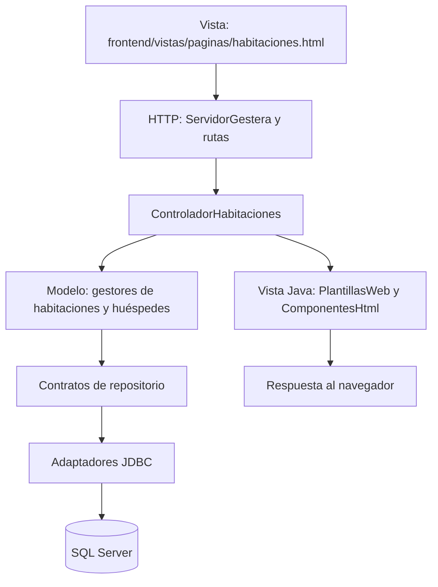

# Mapa de funciones y estructuras de Gestera

El proyecto tiene dos entradas para ubicar el código: [frontend](../../frontend/README.md), con la interfaz, y [backend](../../backend/README.md), con Java y sus pruebas. El instalador SQL está en `base-datos/sqlserver/`.

## Modelo, vista y controlador

Las siguientes rutas Java parten de `backend/src/main/java/com/gestera/`.

| Parte de MVC | Ubicación real | Responsabilidad y ejemplos |
|---|---|---|
| Modelo | `modelo/` | Datos y reglas por función del hotel: `DatosHuesped`, `PedidoServicio`, `InventarioHotel` y gestores. |
| Vista | `frontend/vistas/`, `frontend/publico/` y `backend/.../vistas/` | Plantillas y recursos de interfaz más su renderizado en Java con `PlantillasWeb`, `ComponentesHtml` y `RecursosWeb`. |
| Controlador | `controladores/` | Autoriza, interpreta la solicitud, llama a los gestores y elige la respuesta. Ejemplo: `ControladorHabitaciones`. |

El MVC de Gestera es una separación de responsabilidades sobre `HttpServer` del JDK. Spring Boot administra el arranque y la infraestructura. Las rutas y el acceso general también se coordinan en `infraestructura/servidor/ServidorGestera.java`.

## Otras estructuras que utiliza

| Estructura | Dónde se ve | Cómo se utiliza |
|---|---|---|
| Organización por capas | `modelo`, `controladores`, `vistas`, `repositorios`, `seguridad`, `infraestructura` | Agrupa responsabilidades para encontrar y mantener cada parte. |
| Módulos funcionales | Subcarpetas de `modelo/` y `repositorios/` | Separa habitaciones, huéspedes, hoteles, áreas, reportes y servicio al cuarto. |
| Servicios de negocio | Clases `Gestor*` dentro de `modelo/` | Aplican reglas, validaciones y cálculos. `modelo/servicios` es el módulo concreto de servicio al cuarto. |
| Repositorio / DAO | Interfaces `Repositorio*` dentro de `repositorios/` | Expone operaciones de consulta y guardado mediante contratos. |
| Adaptadores de datos | Implementaciones `*Jdbc` y `*Memoria` | Implementan los contratos para SQL Server o almacenamiento temporal. |
| Inyección por constructor | Constructores de controladores, gestores y repositorios | Reciben las dependencias que necesitan. Spring compone la infraestructura y el servidor conecta los módulos. |
| Transacciones | `infraestructura/persistencia/TransaccionesHotel.java` | Confirma o revierte operaciones relacionadas de un hotel. |
| Seguridad compartida | `seguridad/autenticacion/` y `seguridad/sesiones/` | Valida acceso, limita intentos y mantiene autorizaciones temporales. Las llaves independientes se administran en `modelo/hoteles/`. |
| Pruebas automatizadas | `backend/src/test/java/com/gestera/` | Verifica reglas, plantillas, servidor, configuración e integración. |

Los datos de dominio incluyen records y enumeraciones. Algunos, como `Habitacion` y `Hotel`, son tipos internos de `GestorHabitacionesHoteles` y `CatalogoHoteles`. Por eso se encuentran buscando el nombre del tipo dentro de esos archivos.

## Dónde encontrar cada función

Las rutas abreviadas de Java en esta tabla se resuelven dentro de `backend/src/main/java/com/gestera/`.

| Función | Interfaz en `frontend/` | Control / coordinación Java | Modelo / reglas Java | Persistencia Java |
|---|---|---|---|---|
| Acceso general | `vistas/paginas/acceso.html`, `publico/scripts/acceso.js` | `infraestructura/servidor/ServidorGestera.java` | `seguridad/autenticacion/`, `seguridad/sesiones/` | Sesión temporal |
| Selección de hotel y llave | `vistas/paginas/panel.html`, `publico/scripts/hoteles.js` | `infraestructura/servidor/ServidorGestera.java` | `modelo/hoteles/` | `repositorios/hoteles/` |
| Panel inicial | `vistas/paginas/gestion.html`, `publico/scripts/gestion.js` | `infraestructura/servidor/ServidorGestera.java` | `modelo/hoteles/` | Datos del hotel |
| Configuración | `vistas/paginas/configuracion-hotel.html`, `publico/scripts/configuracion-hotel.js` | `controladores/ControladorConfiguracionHotel.java` | `modelo/habitaciones/`, `modelo/hoteles/` | `repositorios/habitaciones/`, `repositorios/hoteles/` |
| Habitaciones | `vistas/paginas/habitaciones.html`, `publico/scripts/habitaciones.js` | `controladores/ControladorHabitaciones.java` | `modelo/habitaciones/` | `repositorios/habitaciones/` |
| Limpieza | La misma plantilla y script de habitaciones | `controladores/ControladorHabitaciones.java` | `modelo/habitaciones/` | El mismo inventario de habitaciones |
| Huéspedes | `vistas/paginas/huespedes.html` | `controladores/ControladorHuespedes.java` | `modelo/huespedes/` | `repositorios/huespedes/` |
| Servicio al cuarto | `vistas/paginas/servicio-habitacion.html`, `publico/scripts/servicio-habitacion.js` | `controladores/ControladorServicioHabitacion.java` | `modelo/servicios/` | `repositorios/servicios/` |
| Áreas comunes | `vistas/paginas/areas-comunes.html`, `publico/scripts/areas-comunes.js` | `controladores/ControladorAreasComunes.java` | `modelo/areas/` | `repositorios/areas/` y registro en `repositorios/huespedes/` |
| Reportes | `vistas/paginas/reportes.html`, `publico/scripts/reportes.js` | `controladores/ControladorReportes.java` | `modelo/reportes/` | `repositorios/reportes/` y datos de servicios |
| Conexión SQL Server | Configuración de ejecución | `infraestructura/configuracion/` | Propiedades de conexión | `backend/src/main/resources/application-sqlserver.properties` |

## Recorrido de una ocupación

El controlador agrupa habitación, estancia, personas y pago dentro de una transacción. El servidor valida datos y calcula importes y horarios; JavaScript proporciona interacción y vistas previas.

## Compilación y recursos

El `pom.xml` de la raíz define:

- Fuentes Java: `backend/src/main/java`.
- Pruebas Java: `backend/src/test/java`.
- Configuración: `backend/src/main/resources`.
- Plantillas: `frontend/vistas`, incorporadas a la raíz del classpath.
- Recursos públicos: `frontend/publico`, incorporados a `publico` en el classpath.

El resultado es `distribucion/gestera.jar`. Las rutas HTTP y las rutas internas de las plantillas se mantienen. Los lanzadores de la raíz y los scripts de `herramientas/` siguen siendo los puntos de compilación, ejecución y pruebas.

## Frase para la exposición

«El frontend contiene lo que ve y utiliza la persona. El backend contiene las reglas y el acceso a los datos. Dentro del backend distinguimos el modelo, la vista y el controlador; además separamos repositorios, seguridad e infraestructura. Para ubicar una función, seguimos su pantalla, su controlador, sus reglas y su repositorio».
