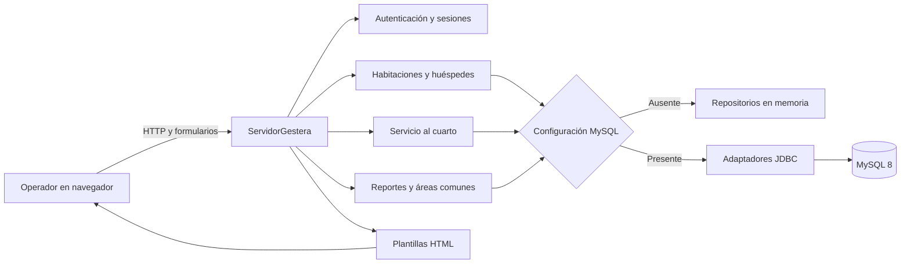

> Referencia histórica anterior al modelo SQL Server V2. El esquema implementado, sus 14 tablas y atributos se describen en [SQLSERVER_14_TABLAS.md](../database-design/SQLSERVER_14_TABLAS.md).

# Gestera — documentación técnica en Markdown

## 1. Propósito de este documento

Este archivo funciona como README técnico y página base de una wiki para el equipo que mantiene Gestera. Resume cómo está organizado el repositorio, cómo se compila, qué componentes participan y cuáles datos se conservan. Su contenido fue contrastado con el código fuente, las migraciones `V001` a `V005`, las plantillas web, los scripts y las pruebas automatizadas.

Gestera es una aplicación web para la operación de cuatro hoteles. Permite controlar el acceso por llaves, administrar habitaciones y limpieza, registrar huéspedes y visitas a áreas comunes, tramitar pedidos de servicio al cuarto y consultar ingresos confirmados. No existe un módulo de reservas, usuarios, empleados o roles.

## 2. Ficha técnica

| Elemento | Implementación real |
|---|---|
| Backend | Java 17, sin Spring ni otro framework |
| Servidor web | `com.sun.net.httpserver.HttpServer` del módulo `jdk.httpserver` |
| Frontend | HTML5, CSS y JavaScript sin bibliotecas externas |
| Base de datos | MySQL 8.0 o superior, opcional |
| Acceso a datos | JDBC mediante MySQL Connector/J |
| Construcción | Maven Wrapper y scripts de PowerShell; no usa Gradle ni Node.js |
| Empaquetado | JAR ejecutable en `distribucion/gestera.jar` |
| Pruebas | Runner Java propio con aserciones, sin JUnit |
| Zona horaria de negocio | `America/Lima` |
| Interfaz | Español, moneda PEN (soles) |

## 3. Estructura del repositorio

```text
GESTERAFINALDEFINALES/
├── base-datos/
│   └── migraciones/                 Migraciones MySQL V001..V005
├── bibliotecas/                     Ubicación local de Connector/J
├── src/
│   ├── main/
│   │   ├── java/com/gestera/        Código Java por módulos
│   │   └── resources/               HTML, CSS y JavaScript
│   └── test/java/com/gestera/       Pruebas automatizadas
├── distribucion/                    JAR y librerías de ejecución
├── docs/
│   ├── database-design/             Modelos lógico, físico y UML
│   └── documentacion-sistema/       Entregables de documentación
├── herramientas/                    Compilar, ejecutar y probar
├── .mvn/                             Configuración Maven Wrapper
├── pom.xml                           Dependencias y ciclo de build
├── mvnw.cmd                          Lanzador Maven para Windows
├── COMPILAR_GESTERA.cmd             Lanzador de compilación para Windows
├── INICIAR_GESTERA.cmd              Lanzador de la aplicación para Windows
└── README.md                         Guía del proyecto
```

`target/` contiene la compilación de Maven. `.compilacion/` conserva el caché local de Maven y copias temporales de ejecución; ninguna de las dos carpetas forma parte del código fuente.

## 4. Módulos del código

| Paquete | Responsabilidad |
|---|---|
| `com.gestera` | Punto de entrada `GesteraAplicacion` |
| `areas` | Catálogo fijo de áreas comunes y registro de visitas |
| `autenticacion` | Validación criptográfica de llaves y limitación de intentos |
| `configuracion` | Lectura de propiedades JVM y variables de entorno |
| `habitaciones` | Inventarios por hotel, secciones tarifarias, estados, pagos y horarios |
| `hoteles` | Catálogo de cuatro hoteles y llaves independientes por hotel |
| `huespedes` | Validación, historial y repositorios de huéspedes y estancias |
| `reportes` | Pagos de habitación, consolidación y desglose de ingresos |
| `servicios` | Catálogo y pedidos de servicio al cuarto |
| `servidor` | Rutas, lectura de formularios, respuestas HTTP y coordinación |
| `sesiones` | Sesiones opacas en memoria y autorización versionada por hotel |
| `vistas` | Plantillas, componentes HTML y recursos públicos permitidos |

Las fachadas principales son `ServidorGestera`, `GestorHabitacionesHoteles`, `GestorHuespedesHoteles`, `GestorServicioHabitacion`, `GestorReportes` y `PlantillasWeb`. Los repositorios separan las reglas de negocio de la persistencia JDBC o en memoria.

## 5. Compilación y ejecución

### Requisitos

- JDK 17 o superior con `java`, `javac`, `jar` y `javadoc` en `PATH`.
- PowerShell 5.1 o superior.
- Navegador web actual.
- MySQL 8.0+ y Connector/J solamente si se requiere persistencia.

### Opción gráfica en Windows

1. Ejecutar `COMPILAR_GESTERA.cmd` para generar el JAR.
2. Ejecutar `INICIAR_GESTERA.cmd` para compilar e iniciar el servidor.
3. Abrir `http://127.0.0.1:8080`.
4. Detener el proceso con `Ctrl+C`.

### Desde PowerShell

```powershell
./herramientas/compilar.ps1
./herramientas/ejecutar.ps1
```

Para utilizar el JAR existente sin recompilar:

```powershell
./herramientas/ejecutar.ps1 -OmitirCompilacion
```

### Pruebas

```powershell
./herramientas/probar.ps1
```

La estructura actual contiene 55 archivos Java principales y 16 archivos de prueba. El runner informa **144 pruebas superadas** en configuración, autenticación, hoteles, habitaciones, huéspedes, áreas comunes, sesiones, servicio al cuarto, reportes, vistas, DAO JDBC y servidor HTTP.

## 6. Configuración

Una propiedad JVM tiene prioridad sobre su variable de entorno. Si ninguna está definida, se usa el valor local predeterminado.

| Propiedad JVM | Variable de entorno | Predeterminado | Función |
|---|---|---|---|
| `gestera.llave.acceso` | `GESTERA_LLAVE_ACCESO` | `123456789abc` | Llave general del servicio |
| `gestera.llave.hotel` | `GESTERA_LLAVE_HOTEL` | `gesteraperu123` | Llave inicial de cada hotel |
| `gestera.direccion` | `GESTERA_DIRECCION` | `127.0.0.1` | Dirección de escucha |
| `gestera.puerto` | `GESTERA_PUERTO` | `8080` | Puerto HTTP |
| `gestera.cookie.segura` | `GESTERA_COOKIE_SEGURA` | `false` | Añade `Secure` a la cookie |
| `gestera.db.url` | `GESTERA_DB_URL` | Sin valor | URL JDBC de MySQL |
| `gestera.db.usuario` | `GESTERA_DB_USUARIO` | Sin valor | Usuario de MySQL |
| `gestera.db.contrasena` | `GESTERA_DB_CONTRASENA` | Sin valor | Contraseña de MySQL |

Las tres opciones de base de datos deben configurarse juntas. Un ejemplo local es:

```powershell
$env:GESTERA_DB_URL = 'jdbc:mysql://127.0.0.1:3306/gestera?useUnicode=true&characterEncoding=UTF-8&serverTimezone=America/Lima'
$env:GESTERA_DB_USUARIO = 'gestera_app'
$env:GESTERA_DB_CONTRASENA = 'cambia-esta-contrasena'
./herramientas/ejecutar.ps1
```

Las llaves predeterminadas son únicamente para evaluación local. Antes de un despliegue deben reemplazarse y debe habilitarse una cookie segura bajo HTTPS.

## 7. Persistencia vigente

Las migraciones se ejecutan en este orden:

1. `V001__registro_huespedes.sql`: hoteles, huéspedes, estancias y relación estancia-huésped.
2. `V002__color_estancia_y_busquedas.sql`: color histórico e índices de búsqueda.
3. `V003__servicio_habitacion.sql`: pedidos e ítems.
4. `V004__areas_comunes_y_ubicacion.sql`: ubicación textual y habitaciones opcionales para visitas.
5. `V005__ingresos_habitaciones_y_reportes.sql`: pagos consolidados de habitaciones.

Después de V005, el esquema usado por los repositorios contiene siete tablas: `hoteles`, `huespedes`, `estancias`, `estancia_huespedes`, `pedidos_servicio`, `pedido_servicio_items` e `ingresos_habitacion`.

Con MySQL se conservan huéspedes, estancias, visitas a áreas comunes, pedidos, ítems e ingresos de habitaciones. Sin MySQL, estos módulos usan repositorios en memoria. En ambos casos, las llaves de hotel, inventarios, secciones, tarifas, estados operativos, pago operativo y catálogo editable del servicio permanecen en memoria y se reinician al detener el proceso.

El archivo `docs/database-design/04-sql/database_schema.sql` contiene un **diseño físico objetivo** de 14 tablas. Sirve como propuesta académica de normalización, pero no sustituye las migraciones ni es compatible con los repositorios actuales sin adaptar el código Java.

## 8. Flujo de arquitectura



La interfaz no consume una API JSON. El navegador envía formularios `application/x-www-form-urlencoded`; el servidor responde con HTML, texto de error o redirecciones `303 See Other`.

## 9. Reglas que deben preservarse

- La autenticación ocurre en dos etapas: llave general y llave del hotel.
- Cada hotel mantiene autorización, llave, inventario y catálogo independientes.
- Una sesión dura 30 minutos y la cookie es `HttpOnly` y `SameSite=Strict`.
- Tras cinco fallos consecutivos de acceso por origen se bloquean nuevos intentos durante 30 segundos.
- Un hotel administra de 1 a 50 habitaciones y de 1 a 12 secciones tarifarias.
- Sólo una habitación ocupada puede tener entre 1 y 8 huéspedes y recibir pedidos.
- El servidor calcula tarifa, total, check-in y check-out; no confía en esos valores enviados por el navegador.
- Las ampliaciones permitidas son 1, 2 o 4 horas, con un cargo positivo independiente.
- El check-out sólo se confirma cuando la hora límite llegó y cambia el estado a `LIMPIEZA_PENDIENTE`.
- Los pedidos siguen `PENDIENTE → EN_PREPARACION → ENTREGADO`; desde los dos primeros estados se permite cancelar.
- Los reportes incluyen habitaciones pagadas y pedidos entregados, nunca valores pendientes.

## 10. Seguridad implementada

- Las llaves se derivan con `PBKDF2WithHmacSHA256`, 65 536 iteraciones, sal aleatoria de 16 bytes y salida de 256 bits.
- Los arreglos que contienen llaves se sobrescriben cuando dejan de usarse.
- Los tokens de sesión contienen 32 bytes aleatorios y sólo se guardan en el servidor.
- La autorización del hotel incluye la versión de su llave; cambiarla invalida autorizaciones antiguas.
- Se limitan el tamaño de formularios y consultas, se rechazan campos repetidos y se usan sentencias JDBC preparadas.
- Las respuestas incorporan CSP, `X-Content-Type-Options`, `X-Frame-Options`, `Referrer-Policy` y `Permissions-Policy`.

Estas medidas no convierten al servidor integrado en una plataforma lista para Internet. Un despliegue real todavía requiere HTTPS, gestor de secretos, usuario MySQL con privilegios mínimos, copias de seguridad, auditoría y persistencia del estado que hoy vive en memoria.

## 11. Guía breve de mantenimiento

1. Identificar el módulo dueño de la regla antes de modificar `ServidorGestera`.
2. Mantener la validación decisiva en Java, aunque exista una validación equivalente en JavaScript.
3. Agregar una migración nueva en vez de editar una migración aplicada.
4. Conservar instantáneas históricas de tarifas, colores, nombres y precios.
5. Actualizar pruebas y documentación cuando cambien rutas, campos o límites.
6. Ejecutar `./herramientas/probar.ps1` antes de generar `distribucion/gestera.jar`.

## 12. Fuentes internas revisadas

- `README.md` y scripts de `herramientas/`.
- Los 55 archivos de `src/main/java/`.
- Plantillas, fragmentos, CSS y JavaScript de `src/main/resources/`.
- Los 16 archivos de `src/test/java/`.
- Migraciones `base-datos/migraciones/V001..V005`.
- Diagramas, SQL objetivo y memoria técnica de `docs/database-design/`.

