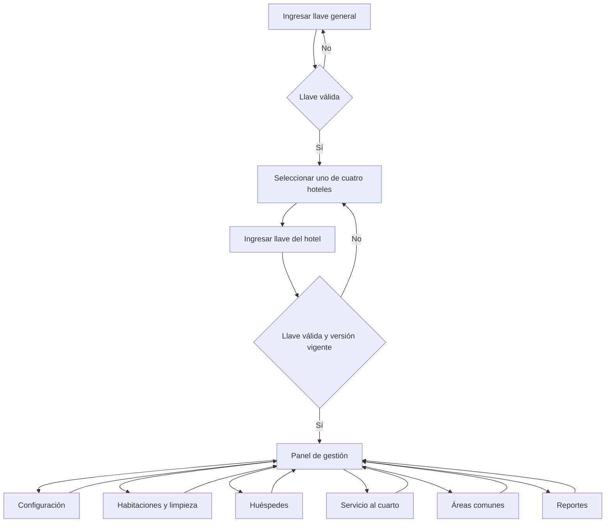
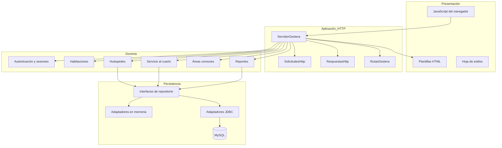
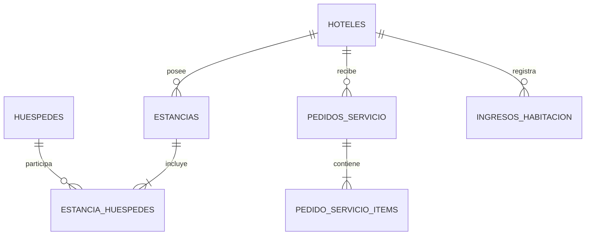

> Referencia histórica anterior al modelo SQL Server V2. El esquema implementado, sus 14 tablas y atributos se describen en [SQLSERVER_14_TABLAS.md](../database-design/SQLSERVER_14_TABLAS.md).

# Descripción del sistema Gestera

## 1. Identificación

**Nombre:** Gestera  
**Tipo:** aplicación web de gestión operativa hotelera  
**Ámbito:** cuatro hoteles registrados en un catálogo interno  
**Idioma y moneda:** español y soles peruanos (PEN)  
**Zona horaria:** `America/Lima`

Gestera centraliza tareas diarias de un establecimiento: control de acceso, configuración de habitaciones y tarifas, registro de huéspedes, limpieza, servicio al cuarto, uso de áreas comunes y reportes de ingresos. La aplicación se ejecuta como un servidor Java y se usa desde un navegador.

## 2. Problema que atiende

La operación de un hotel necesita relacionar rápidamente el estado de sus habitaciones con las personas alojadas, los servicios consumidos y los ingresos confirmados. Si cada dato se maneja por separado, es fácil perder trazabilidad sobre quién ocupa una habitación, cuándo debe salir, qué pedidos están pendientes o qué pagos forman parte de un reporte.

Gestera organiza esta información por hotel y presenta una interfaz común. Su alcance actual se enfoca en la operación durante la estancia; no administra reservas previas, empleados, usuarios nominales, roles, facturación electrónica ni contabilidad completa.

## 3. Objetivo general

Facilitar al operador de un hotel el control de habitaciones, huéspedes y servicios mediante una aplicación web local que aplique reglas consistentes, separe los datos de cada establecimiento y consolide los ingresos confirmados.

## 4. Actores

### 4.1 Operador del hotel

Es la persona que utiliza la interfaz para realizar las tareas operativas. El nombre “operador” describe un rol funcional para esta documentación; el proyecto no almacena una entidad `Usuario`, perfiles ni permisos individuales.

El operador puede:

- ingresar con la llave general y la llave de un hotel;
- cambiar la llave del hotel autorizado;
- configurar habitaciones y secciones tarifarias;
- registrar ocupación, huéspedes, pagos y ampliaciones;
- gestionar estados de limpieza;
- registrar y actualizar pedidos de servicio al cuarto;
- registrar visitantes de áreas comunes;
- consultar huéspedes e ingresos;
- cerrar la sesión.

### 4.2 Servicios técnicos externos

- **MySQL 8.0+:** persistencia opcional de huéspedes, estancias, pedidos e ingresos.
- **Navegador web:** cliente que renderiza HTML/CSS y ejecuta JavaScript.

No se identificaron integraciones con pasarelas de pago, correo, servicios de reservas ni APIs externas.

## 5. Hoteles incluidos

El catálogo está definido en `CatalogoHoteles` y contiene:

| Código | Nombre | Ubicación | Iniciales |
|---|---|---|---|
| `sol-pucusana` | Hotel El Sol de Pucusana | Pucusana, Lima | EP |
| `brisa-marina` | Hotel Brisa Marina | Miraflores, Lima | BM |
| `valle-dorado` | Hotel Valle Dorado | Urubamba, Cusco | VD |
| `costa-serena` | Hotel Costa Serena | Máncora, Piura | CS |

No existe una pantalla para crear o eliminar hoteles. El catálogo es fijo en el código.

## 6. Alcance funcional por módulos

| Módulo | Funciones reales |
|---|---|
| Acceso | Llave general, llave independiente por hotel, límite de intentos y sesiones temporales |
| Configuración del hotel | Cambio de llave, capacidad de 1 a 50 habitaciones y administración de secciones tarifarias |
| Habitaciones | Sección, servicio de 6 o 24 horas, estado, pago, huéspedes, horarios y ampliaciones |
| Limpieza | Vista de habitaciones en `LIMPIEZA_PENDIENTE` o `EN_LIMPIEZA` |
| Huéspedes | Historial por hotel y filtros combinables por nombre, día, intervalo y color |
| Servicio al cuarto | Catálogo por hotel, pedidos, búsqueda y transición de estados |
| Áreas comunes | Registro de visitantes del Jacuzzi, Sauna o Área de juegos por 1, 3 o 5 horas |
| Reportes | Ingresos de habitaciones pagadas y pedidos entregados, por periodo y origen |

## 7. Flujo principal

La autenticación en dos etapas impide que seleccionar un hotel sea suficiente para operar sobre él. La sesión guarda una autorización asociada al código del hotel y a la versión de su llave. Si esa llave cambia, una autorización basada en la versión anterior deja de ser válida.

## 8. Arquitectura

Gestera utiliza una arquitectura modular en capas, aunque no depende de un framework:

### 8.1 Presentación

Las plantillas de `src/main/resources/paginas/` contienen marcadores que `PlantillasWeb` reemplaza por contenido escapado o componentes generados. JavaScript mejora la interacción —modales, filtros visuales, cálculos de vista previa y alertas—, pero las decisiones finales se vuelven a validar en el servidor.

### 8.2 Aplicación HTTP

`ServidorGestera` registra rutas en `HttpServer`, valida sesiones y coordina los gestores. `SolicitudesHttp` limita y decodifica formularios. `RespuestasHttp` aplica encabezados de seguridad y genera HTML, texto o redirecciones.

El servidor usa un `ThreadPoolExecutor` con 4 hilos base, máximo de 8, cola de 64 tareas y política `CallerRunsPolicy`.

### 8.3 Dominio

Cada gestor concentra reglas de su área. Por ejemplo, `GestorHabitacionesHoteles` valida rangos generales y `InventarioHotel` aplica cambios sincronizados al inventario particular. El uso de `record` proporciona vistas inmutables como `Habitacion`, `RegistroHuesped`, `PedidoServicio` e `IngresoHabitacion`.

### 8.4 Persistencia

Los módulos de huéspedes, servicio al cuarto e ingresos dependen de interfaces de repositorio. En el arranque, `ServidorGestera.crear` selecciona todos los adaptadores JDBC si las tres variables de MySQL están presentes; en caso contrario selecciona los adaptadores en memoria.

## 9. Reglas de negocio principales

### 9.1 Seguridad y sesión

- La llave general predeterminada de evaluación es `123456789abc`.
- Cada hotel inicia con `gesteraperu123`, salvo configuración externa.
- La llave nueva de un hotel debe tener entre 8 y 15 caracteres, al menos una mayúscula y un número.
- Las llaves distinguen mayúsculas de minúsculas.
- Una sesión dura 30 minutos.
- Cinco fallos consecutivos por dirección de origen producen un bloqueo de 30 segundos.

### 9.2 Habitaciones y tarifas

- Cada hotel inicia con 12 habitaciones y tres secciones: Amarillo, Celeste y Violeta.
- Las tarifas iniciales de 6/24 horas son S/ 50.00/90.00, S/ 65.00/120.00 y S/ 80.00/150.00.
- La capacidad permitida es de 1 a 50 habitaciones.
- Hay de 1 a 12 secciones por hotel.
- Color y nombre de sección no se repiten dentro del mismo hotel.
- Cada tarifa debe estar entre S/ 1.00 y S/ 10 000.00, con máximo dos decimales.
- No se elimina la última sección ni una sección asignada a una habitación conservada.
- La reducción de capacidad se rechaza si alguna habitación final no está disponible.

### 9.3 Estancias

- Estados: Disponible, Ocupada, Limpieza pendiente, En limpieza y Mantenimiento.
- Una ocupación requiere entre 1 y 8 huéspedes.
- Los servicios de estancia duran 6 o 24 horas.
- El servidor fija el check-in actual y calcula el check-out.
- El ajuste manual del check-out sólo existe para pruebas y nunca puede ser anterior al check-in.
- Las ampliaciones son de 1, 2 o 4 horas y requieren un cargo entre S/ 0.01 y S/ 10 000.00.
- Un cargo nuevo vuelve la estancia a No pagado.
- El check-out vencido cambia la habitación a Limpieza pendiente y conserva los importes y el pago.
- Pasar a Disponible o Mantenimiento limpia los datos operativos de la estancia.

### 9.4 Huéspedes y documentos

- Nombre: de 2 a 100 caracteres, con letras y signos de nombre admitidos.
- DNI: 8 dígitos.
- Carnet de extranjería: 9 a 12 caracteres alfanuméricos.
- Pasaporte: 6 a 12 caracteres alfanuméricos.
- Los documentos se normalizan a mayúsculas y no pueden repetirse dentro de una estancia.

### 9.5 Servicio al cuarto

- Sólo una habitación ocupada puede recibir pedidos.
- Un pedido actual contiene un producto, cantidad de 1 a 10 y observación opcional de hasta 300 caracteres.
- Precio y total se calculan en el backend.
- Flujo: Pendiente → En preparación → Entregado.
- Desde Pendiente o En preparación se permite cancelar.
- Entregado y Cancelado son estados finales.
- Los pedidos guardan una instantánea del producto y su precio.

### 9.6 Áreas comunes y reportes

- Áreas fijas: Jacuzzi, Sauna y Área de juegos.
- Duraciones admitidas: 1, 3 o 5 horas.
- Una visita registra de 1 a 8 personas y se incorpora al historial de huéspedes.
- Los reportes incluyen únicamente estancias pagadas y pedidos entregados.
- Periodos: día, semana, mes, año o rango personalizado de hasta 3 653 días.
- Rangos de más de 62 días se resumen por mes; los demás, por día.

## 10. Modelo de datos vigente

`estancias.ubicacion` permite describir una `Habitación N` o el nombre de un área común. Para estas últimas, `numero_habitacion` es nulo. El diseño físico objetivo incluido en la carpeta de diagramas normaliza más conceptos, pero no corresponde todavía al esquema consumido por JDBC.

## 11. Dependencias y restricciones

La aplicación principal depende sólo de módulos del JDK: `jdk.httpserver` y `java.sql`. Connector/J se carga dinámicamente cuando MySQL está configurado. No hay dependencia en tiempo de ejecución de las imágenes o diagramas del repositorio ni de recursos web externos.

Restricciones conocidas:

- inventarios, tarifas, llaves y catálogo editable no persisten al reiniciar;
- no hay administración dinámica del catálogo de hoteles;
- las visitas a áreas comunes quedan registradas como estancias activas en el esquema vigente y no existe una operación separada para cerrarlas;
- no hay exportación de reportes a PDF, Excel o CSV;
- el servidor integrado está pensado para uso local o académico, no para exposición directa a Internet.

## 12. Conclusión

Gestera es un sistema modular y ejecutable que cubre un circuito operativo coherente: autorizar un hotel, configurar su inventario, registrar la ocupación y los consumos, completar la salida y consultar ingresos confirmados. Su separación por gestores y repositorios facilita probar las reglas sin base de datos y permite sustituir memoria por JDBC en los módulos que ya cuentan con un puerto de persistencia.

