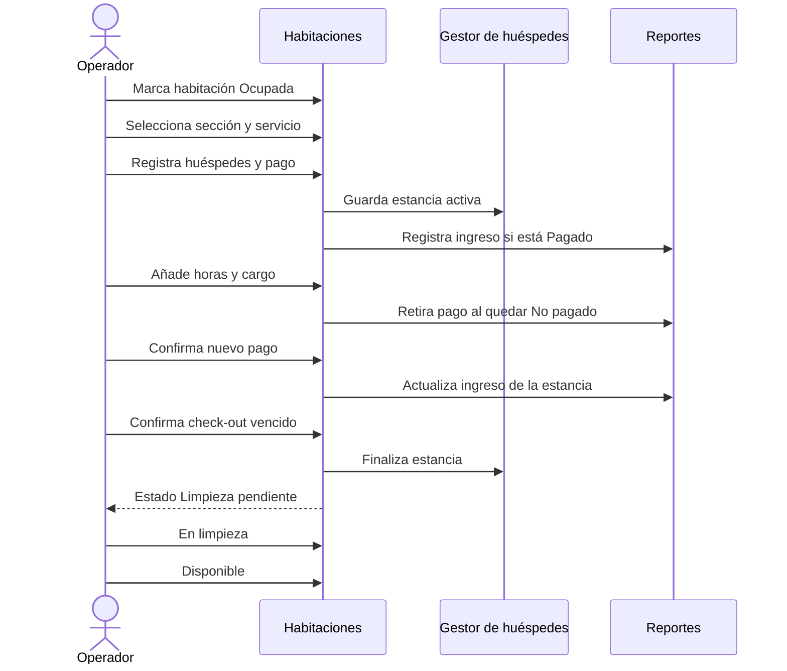

> Referencia histórica anterior al modelo SQL Server V2. El esquema implementado, sus 14 tablas y atributos se describen en [SQLSERVER_14_TABLAS.md](../database-design/SQLSERVER_14_TABLAS.md).

# Gestera — tutoriales y guiones de video

## 1. Uso del material

Este documento reúne cuatro tutoriales demostrativos y sus guiones de grabación. Puede utilizarse como apoyo en una exposición, como narración para videos de pantalla o como base para diapositivas. Los pasos y nombres corresponden a la interfaz real de Gestera.

La grabación recomendada es de pantalla completa a 1080p, con el navegador al 100 % de zoom. Antes de grabar, inicie el servidor, cierre sesiones anteriores y prepare datos ficticios. No muestre variables de entorno, contraseñas reales ni información personal.

## 2. Tutorial 1 — acceso seguro y recorrido general

**Duración sugerida:** 3 minutos 30 segundos  
**Objetivo:** explicar la autenticación en dos etapas y presentar los módulos.  
**Archivo sugerido:** `tutorial-01-acceso-y-panel.mp4`

### Preparación

- Gestera ejecutándose en `http://127.0.0.1:8080`.
- Llaves locales de evaluación disponibles.
- Ningún hotel abierto previamente.

### Guion técnico y narración

| Tiempo | Acción en pantalla | Narración sugerida |
|---|---|---|
| 00:00–00:20 | Mostrar la pantalla inicial | “Gestera es una aplicación web local para organizar la operación de cuatro hoteles. El acceso comienza con una llave general del servicio.” |
| 00:20–00:45 | Escribir la llave general y pulsar Ingresar | “La llave se valida en el servidor. No se incorpora al HTML, JavaScript ni a la cookie.” |
| 00:45–01:10 | Mostrar el buscador y filtrar por `Sol` | “El directorio contiene cuatro hoteles fijos. El buscador filtra por nombre sin modificar el catálogo.” |
| 01:10–01:40 | Abrir Hotel El Sol de Pucusana e ingresar su llave | “Cada hotel tiene una llave independiente. La sesión queda autorizada únicamente para el establecimiento elegido.” |
| 01:40–02:10 | Abrir Configuración requerida y mostrar las reglas | “En el primer acceso se solicita cambiar la llave inicial. Debe tener entre ocho y quince caracteres, una mayúscula y un número.” |
| 02:10–03:05 | Cerrar el cuadro y recorrer las seis tarjetas | “El panel reúne Limpieza, Habitaciones, Huéspedes, Servicio al cuarto, Áreas comunes y Reportes de ingresos.” |
| 03:05–03:30 | Mostrar Cerrar sesión | “Cerrar sesión invalida el token y devuelve al acceso general. La sesión también vence después de treinta minutos.” |

### Ideas clave para la exposición

- No existen cuentas personales ni roles almacenados.
- La llave general y la del hotel cumplen propósitos distintos.
- Cambiar la llave de un hotel invalida autorizaciones basadas en la versión anterior.
- Cinco fallos consecutivos activan una espera de 30 segundos.

## 3. Tutorial 2 — ciclo completo de una habitación

**Duración sugerida:** 7 minutos  
**Objetivo:** demostrar ocupación, huésped, ampliación, pago, check-out y limpieza.  
**Archivo sugerido:** `tutorial-02-ciclo-habitacion.mp4`

### Preparación

- Sesión autorizada para un hotel.
- Habitación 1 Disponible.
- Usar únicamente nombres y documentos ficticios con formato válido.

### Secuencia que se va a demostrar

### Guion técnico y narración

| Tiempo | Acción en pantalla | Narración sugerida |
|---|---|---|
| 00:00–00:30 | Abrir Habitaciones y seleccionar Habitación 1 | “Cada hotel posee su propio inventario. Al iniciar hay doce habitaciones y tres secciones tarifarias.” |
| 00:30–01:15 | Elegir sección, 6 horas y Ocupada | “La sección define el color y las tarifas. El servidor, no el navegador, calcula el precio y los horarios.” |
| 01:15–02:10 | Completar dos huéspedes | “Una habitación ocupada exige entre una y ocho personas. Cada tipo de documento aplica un formato distinto y no se permiten duplicados en la estancia.” |
| 02:10–02:40 | Elegir Pagado y guardar | “El pago confirmado alimenta el reporte. El registro de huéspedes aparece automáticamente en su módulo.” |
| 02:40–03:35 | Reabrir, elegir +2 horas y añadir cargo | “Las ampliaciones admiten una, dos o cuatro horas. El cargo se acumula y la habitación vuelve a No pagado para confirmar el total actualizado.” |
| 03:35–04:05 | Marcar nuevamente Pagado | “Gestera actualiza el ingreso de la misma estancia; no crea un pago duplicado.” |
| 04:05–04:45 | Activar Cambiar hora para pruebas | “Esta opción permite acercar el check-out para demostrar alertas. En operación normal, la salida se calcula a seis o veinticuatro horas.” |
| 04:45–05:30 | Mostrar campana y sus colores | “La alerta cambia de amarillo a naranja y luego a rojo. Sólo una salida vencida permite abrir la confirmación.” |
| 05:30–06:05 | Confirmar check-out | “El check-out finaliza la estancia y mueve la habitación a Limpieza pendiente, sin borrar importes ni pagos.” |
| 06:05–06:40 | Abrir Limpieza y pasar a En limpieza | “La vista de limpieza comparte el mismo inventario, pero sólo muestra estados relacionados con esa tarea.” |
| 06:40–07:00 | Pasar a Disponible | “Al quedar Disponible, el cuarto está listo para una estancia nueva. El historial ya registrado se conserva.” |

### Cierre académico

Este recorrido muestra la separación entre el estado operativo de la habitación, la estancia histórica de los huéspedes y el ingreso confirmado. Esa separación evita perder trazabilidad al liberar el cuarto.

## 4. Tutorial 3 — servicio al cuarto y reporte de ingresos

**Duración sugerida:** 5 minutos  
**Objetivo:** crear un pedido, recorrer estados y comprobar su impacto en reportes.  
**Archivo sugerido:** `tutorial-03-servicio-y-reportes.mp4`

### Preparación

- Una habitación debe estar Ocupada.
- Debe existir al menos un producto en el catálogo.

### Guion técnico y narración

| Tiempo | Acción en pantalla | Narración sugerida |
|---|---|---|
| 00:00–00:35 | Abrir Servicio al cuarto | “Sólo las habitaciones ocupadas aparecen como destinos válidos para un pedido.” |
| 00:35–01:15 | Elegir habitación, producto y cantidad | “La interfaz muestra un total estimado, pero el servidor vuelve a calcular precio, cantidad y total antes de guardar.” |
| 01:15–01:40 | Escribir observación y crear pedido | “El pedido nace Pendiente y conserva una copia del nombre y el precio del producto.” |
| 01:40–02:20 | Cambiar a En preparación | “Las transiciones están controladas. No es posible saltar directamente desde Pendiente hasta Entregado.” |
| 02:20–02:50 | Cambiar a Entregado | “Entregado es un estado final y convierte el pedido en un ingreso reportable.” |
| 02:50–03:25 | Mostrar filtros por estado y búsqueda | “La cola permite filtros visuales y una búsqueda de servidor por fecha, hora exacta y habitación.” |
| 03:25–04:20 | Abrir Reportes, elegir Hoy y Todos | “El reporte combina habitaciones pagadas con pedidos entregados. Pendientes, pedidos en preparación y cancelados se excluyen.” |
| 04:20–05:00 | Mostrar totales, resumen y detalle | “El detalle conserva fecha, origen, habitación, concepto y monto. Rangos largos se agrupan por mes.” |

### Variante corta: catálogo

Como demostración adicional de un minuto:

1. Abra **Administrar catálogo**.
2. Cambie el precio de un producto.
3. Muestre que el pedido ya creado conserva el precio anterior.
4. Cree una categoría vacía y elimínela.
5. Explique que una categoría con productos no puede eliminarse.

## 5. Tutorial 4 — áreas comunes y consulta de huéspedes

**Duración sugerida:** 4 minutos  
**Objetivo:** registrar una visita independiente de habitaciones y encontrarla en el historial.  
**Archivo sugerido:** `tutorial-04-areas-y-huespedes.mp4`

### Guion técnico y narración

| Tiempo | Acción en pantalla | Narración sugerida |
|---|---|---|
| 00:00–00:30 | Abrir Áreas comunes | “Gestera ofrece tres espacios fijos: Jacuzzi, Sauna y Área de juegos.” |
| 00:30–01:10 | Seleccionar un área y duración | “La entrada usa la hora de Perú. Al elegir una, tres o cinco horas, la salida se calcula automáticamente.” |
| 01:10–02:00 | Registrar dos visitantes | “Los visitantes usan las mismas reglas de nombre y documento que una habitación.” |
| 02:00–02:25 | Guardar y observar redirección | “Al guardar, Gestera abre el historial de huéspedes. El área aparece como ubicación y no ocupa ningún cuarto.” |
| 02:25–03:15 | Filtrar por nombre y día | “Los criterios pueden combinarse. El nombre busca coincidencias parciales y el día corresponde al check-in.” |
| 03:15–04:00 | Mostrar intervalo y color | “El intervalo encuentra estancias superpuestas. El color sólo corresponde a habitaciones, por lo que no se usa para una visita de área común.” |

## 6. Tutorial escrito rápido — preparar MySQL

**Objetivo:** conservar los módulos que ya tienen repositorio JDBC.

1. Instale MySQL 8.0+.
2. Ejecute `V001`, `V002`, `V003`, `V004` y `V005` en ese orden.
3. Copie MySQL Connector/J en `bibliotecas/`.
4. Configure `GESTERA_DB_URL`, `GESTERA_DB_USUARIO` y `GESTERA_DB_CONTRASENA` juntas.
5. Inicie Gestera desde esa terminal.
6. Registre huéspedes, un pedido y un pago.
7. Reinicie y compruebe el historial.

No presente `docs/database-design/04-sql/database_schema.sql` como migración actual: es un diseño objetivo que requiere cambios en los repositorios.

## 7. Propuesta de diapositivas para exposición

| Diapositiva | Contenido | Evidencia que se muestra |
|---|---|---|
| 1 | Problema y objetivo | Panel principal de Gestera |
| 2 | Tecnologías | Java 17, HttpServer, HTML/CSS/JS y MySQL opcional |
| 3 | Arquitectura | Diagrama de capas de `03-descripcion-del-sistema.md` |
| 4 | Seguridad | Acceso en dos etapas, PBKDF2, sesión y límite de intentos |
| 5 | Flujo de estancia | Tutorial 2 y estados de habitación |
| 6 | Servicios adicionales | Pedido y área común |
| 7 | Persistencia | Esquema vigente frente al diseño objetivo |
| 8 | Calidad | Resultado de 144 pruebas superadas |
| 9 | Limitaciones | Datos aún en memoria y ausencia de reservas/usuarios |
| 10 | Conclusión | Beneficio operativo y evolución posible |

## 8. Lista de comprobación antes de grabar

- [ ] El JAR compila y las 144 pruebas pasan.
- [ ] La consola y las credenciales reales no aparecen en pantalla.
- [ ] Los nombres y documentos usados son ficticios.
- [ ] El navegador está en español y la ventana no muestra datos personales.
- [ ] La habitación elegida tiene el estado requerido para el tutorial.
- [ ] La hora de prueba permite mostrar la alerta sin una espera extensa.
- [ ] Los movimientos aparecen dentro del periodo seleccionado en Reportes.
- [ ] La narración distingue funciones actuales de mejoras futuras.
- [ ] No se afirma que exista un módulo de reservas, usuarios o facturación.

## 9. Frase de cierre sugerida

“Gestera concentra un flujo hotelero verificable: protege el acceso, administra la estancia, relaciona huéspedes y consumos, acompaña la salida y presenta únicamente ingresos confirmados. Su diseño modular permite demostrarlo sin base de datos y activar MySQL en los módulos que ya implementan persistencia.”

